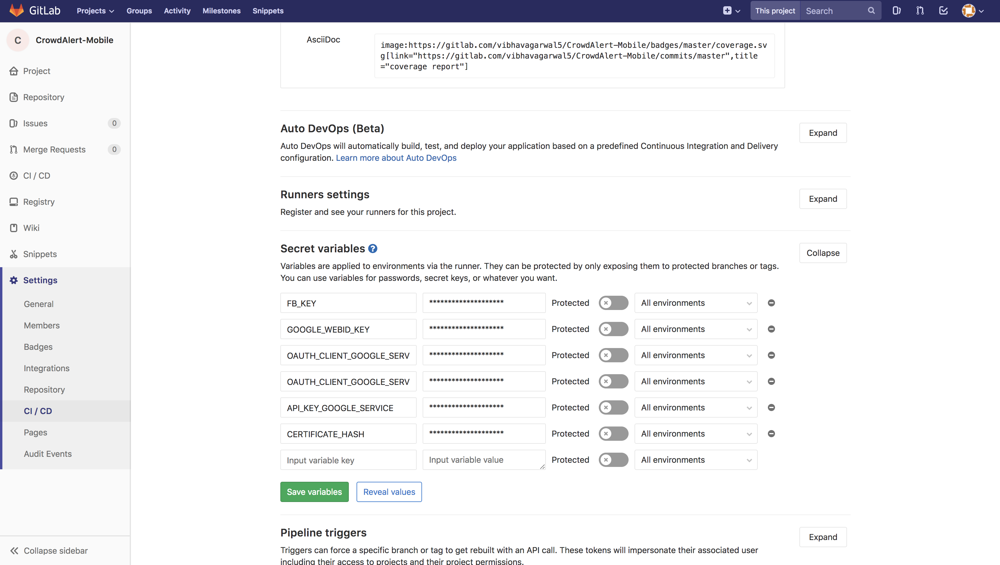

# CrowdAlert

A crowdsourced hybrid mobile application using React Native for reporting and viewing incidents around the globe.

## Install basic Dependencies

This project is built using React Native. You will need the following dependencies.

### Node and Watchman

Install Node and Watchman using Homebrew.

```
brew install node
brew install watchman
```

### React Native CLI

Install React Native CLI globally.

```
npm install -g react-native-cli
```

### NPM Dependencies

Install package-dependencies using NPM

```
npm install
```

## Setting up the keys

### On your local machine

Create a `keys.env` file add your keys like following:

```
FB_KEY=
GOOGLE_WEBID_KEY=
OAUTH_CLIENT_GOOGLE_SERVICE_KEY1=
OAUTH_CLIENT_GOOGLE_SERVICE_KEY3=
API_KEY_GOOGLE_SERVICE=
CERTIFICATE_HASH=
```

After adding this `keys.env` file run:

```
bash createKeys.sh
```

to sync your keys with the project.

**Location:**

*   *FB_KEY* -> `android/app/src/main/res/values/strings.xml`
*   *GOOGLE_WEBID_KEY* -> `src/components/login.js`
*   *OAUTH_CLIENT_GOOGLE_SERVICE_KEY1* -> `src/components/login.js`
*   *OAUTH_CLIENT_GOOGLE_SERVICE_KEY3* -> `android/app/google-services.json`
*   *API_KEY_GOOGLE_SERVICE* -> `android/app/google-services.json`
*   *CERTIFICATE_HASH* -> `android/app/google-services.json`

Compare the `google-services.json` file that you download from the firebase console and add these keys carefully.

**_Note:_** Ensure that before you run `react-native run-android` or `react-native run-ios`, you setup your keys using the above method, otherwise your build will crash.

### On your Forked repository for CI pipeline

Add the above keys with the same name in the secret variables section in the **Settings -> CI/CD -> Secret Variables** section of your forked repository. <br>
Example:


## Install Other Dependencies

### Android (Android Studio)

#### Download and install Android Studio

Download Android Studio, then follow the installation instructions. Choose Custom installation when prompted by the Setup Wizard, and proceed to the next step.

#### Install AVD and HAXM

Make sure the boxes next to all of the following are checked:

*   Android SDK
*   Android SDK Platform
*   Performance (Intel ® HAXM)
*   Android Virtual Device

Click 'Next' to install all of these components

#### Install the Android 6.0 (Marshmallow) or above SDK

This project requires Android 6.0 (Marshmallow) or above SDK. Make sure the following items are all checked

*   Google APIs
*   Android SDK Platform 23
*   Intel x86 Atom_64 System Image
*   Google APIs Intel x86 Atom_64 System Image

#### Set up the ANDROID_HOME environment variable

Add the following lines to your `~/.profile` (or equivalent eg: `~/.bash_profile`) config file:

```
export ANDROID_HOME=${HOME}/Library/Android/sdk
export PATH=${PATH}:${ANDROID_HOME}/tools
export PATH=${PATH}:${ANDROID_HOME}/platform-tools
```

Type `source ~/.profile` to load the config into your current shell.

#### Firebase API key

Follow these steps to get your firebase API key

1.  Browse https://console.firebase.google.com
2.  Generate an empty project
3.  Navigate different icons in DEVELOP to get authDomain, databaseUrl, projectID, storageBucket, messagingSenderID and add them to keys.js in app/config/keys.js
4.  Go to settings/general in the firebase console and download the google-services.json file and add it to PROJECT_NAME/android/app

#### Google Maps API key

1.  Browse https://developers.google.com/maps/documentation/javascript/get-api-key
2.  Choose GET A KEY option on the top right
3.  Select an existing project or create a new one
4.  Copy the API key to android/app/src/main/res/values/strings.xml

#### Update your Android SDK location

Add android/local.properties file

```
sdk.dir=<your android sdk location>
```

#### Running the App

```
cd <project-dir>
react-native run-android
```

### iOS (Xcode)

#### Xcode

Make sure you have Xcode 8 or higher and the correct command line tool is specified

#### Pods Dependencies

Install pods using cocoa-pods

```
cd <project-dir>/ios
pod install
```

#### Rename Info.plist

```
cd <project-dir>/ios
mv Info.plist.sample Info.plist
```

#### Facebook SDK

Follow Step 2, 3, 4 on https://developers.facebook.com/docs/ios/getting-started/.

#### Google Sign In + Firebase

1.  Follow the Step **Add Firebase to your app** on https://firebase.google.com/docs/ios/setup.
2.  Open your `Info.plist` file and change {reverse-google-client-id} with the value from `GoogleService-Info.plist`.

#### Editing Native Project

For editing native project, use only `CarbonFootprint.xcworkspace` not `CarbonFootprint.xcodeproj`

#### Running the App

```
cd <project-dir>
react-native run-ios
```

You can also run it directly from within Xcode or Nuclide.
